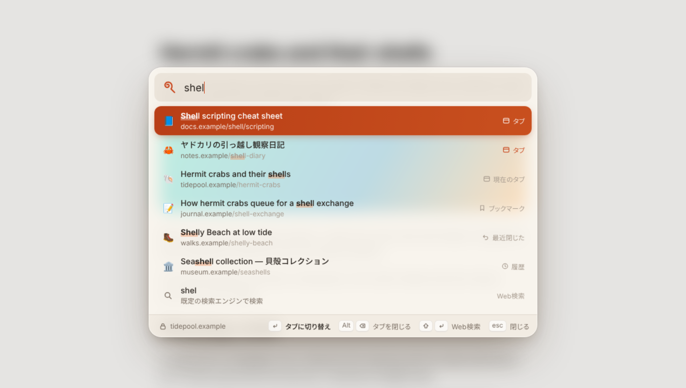

<div align="center">


# Yadokari

**Chromeにコマンドバーとタブの自動アーカイブを足す拡張機能。**

[](https://github.com/eucyt/yadokari/actions/workflows/test.yml)
[](https://github.com/eucyt/yadokari/releases/latest)
[](LICENSE)


[English](README.md) | 日本語

<picture>
  <source media="(prefers-color-scheme: dark)" srcset="docs/bar-dark.png">
  
</picture>

</div>

名前はヤドカリから取りました。Chromeを殻に見立てて、住みやすくする道具を持ち込みます。

## 機能

| 機能 | 内容 |
|---|---|
| コマンドバー | タブ、ブックマーク、履歴、最近閉じたタブを1つの入力欄から曖昧検索します。`>` で始めると、タブの複製、ピン留め、URLのコピーなどのコマンドを探せます。 |
| タブの自動クローズ | 12時間使っていないタブを閉じ、アーカイブに30日間残します。ピン留めしたタブ、表示中のタブ、音声を再生中のタブは閉じません。 |

## インストール

Chromeウェブストアでは配布していません。パッケージ化されていない拡張機能として読み込みます。

1. [Releases](https://github.com/eucyt/yadokari/releases/latest) から `yadokari-<バージョン>.zip` をダウンロードして展開します。
2. `chrome://extensions` を開き、「デベロッパー モード」をオンにします。
3. 「パッケージ化されていない拡張機能を読み込む」で、展開したフォルダを選びます。
4. `chrome://extensions/shortcuts` でショートカットを確認します。他の拡張機能と衝突して空欄なら、手で割り当ててください。

更新するときは、新しいzipを同じフォルダに展開し直して拡張機能を再読み込みします。

## 使い方

macOSでは **⌃T**、それ以外では **Ctrl+Shift+K** で開きます。⌘TはChromeが予約していて、拡張機能には割り当てられません。

| キー | 動作 |
|---|---|
| ↑↓、Tab、Ctrl+N / Ctrl+P | 選択を移動 |
| Enter | タブなら切り替え、それ以外は新しいタブで開く |
| ⌥Enter | 現在のタブで開く |
| ⇧Enter | 入力した文字列をWeb検索 |
| Ctrl+⌫ | 選択中のタブを閉じる |
| Esc | バーを閉じる |

WindowsとLinuxでは⌥がAltに、タブを閉じるキーがAlt+⌫に変わります。

何も入力しないと、他のタブが最近使った順に並びます。⌃Tに続けてEnterを押せば、直前のタブに戻れます。

<details>
<summary>検索の詳細</summary>

- スペースで区切った語は、すべてに一致する行だけが残ります。
- URLらしい入力(`github.com`、`localhost:3000`)には、先頭に「このURLを開く」が出ます。
- 一致が0件のときは、1文字の脱字か隣同士の入れ替えを許して探し直します。
- フッターには、バーを開いたページのホスト名が出ます。HTTPSでないページでは警告色になります。
- フッターには、選択中の行でEnterを押すと何が起きるかと、その行で使えるほかのキーも出ます。
- バーの配色はシステムのライト・ダークに従います。ページの上に開くと背後のページをぼかします。システムで透明度を下げる設定にしているときはぼかしません。

</details>

<details>
<summary>自動クローズの詳細</summary>

- `>` の「アーカイブしたタブを表示」で一覧し、Enterで開き直せます。アーカイブは最大500件で、通常の検索には混ざりません。
- シークレットウィンドウのタブは閉じますが、記録しません。
- 止めるときは `>` の「タブの自動クローズをオフにする」を実行します。オンに戻すと、すべてのタブがそこから12時間の猶予を得ます。
- タイマーは使っていません。タブを切り替える、開く、閉じる、読み込むといった操作のたびに期限切れのタブを閉じるので、席を外している間は何も閉じません。
- 開き直したタブはURLを読み込み直します。戻る/進むの履歴と入力途中のフォームは戻りません。

</details>

<details>
<summary>設定</summary>

拡張機能のオプション、または `>` の「Yadokariの設定を開く」から開きます。

| 項目 | 既定 | 範囲 |
|---|---|---|
| 履歴の対象期間 | 90日 | 1〜365日 |
| 履歴の最大件数 | 4,000件 | 100〜20,000件 |
| 未入力時に表示する「最近閉じたタブ」 | 5件 | 0〜25件 |
| Enterで開く先 | 新しいタブ | 新しいタブか現在のタブ。⌥Enterは選ばなかったほうで開きます。 |

</details>

## プライバシーと権限

- **通信しません。** 検索は、Chromeのタブ、ブックマーク、履歴、セッションのAPIから読んだ内容に対してメモリ上で行います。
- **Webサイトへの常時アクセス権を求めません。** バーの挿入には `activeTab` を使うので、権限が付くのはショートカットを押したタブだけです。
- **ページからバーを読めません。** バーは拡張機能のページを `iframe` で重ねたもので、入力内容も検索結果もページのスクリプトからは見えません。
- **依存ライブラリもビルド工程もありません。** このリポジトリにあるファイルを、Chromeがそのまま実行します。

これらの決まりは `test/guardrails.test.js` がコミットのたびに検査しています。

<details>
<summary>権限ごとの用途</summary>

| 権限 | 用途 |
|---|---|
| `tabs` | タブのタイトルとURLを読む、タブを切り替える |
| `bookmarks` `history` `sessions` | 検索対象の取得、閉じたタブの復元 |
| `activeTab` `scripting` | ショートカットを押したタブにバーを挿入 |
| `search` | 既定の検索エンジンでのWeb検索 |
| `favicon` | 行のアイコン表示 |
| `storage` | 設定、アーカイブ、自動クローズの状態を `storage.local` に保存。セッションごとのトークン、タブの最終使用時刻、ブックマークと履歴のキャッシュは `storage.session` に置き、ブラウザの終了で消えます。 |

</details>

## 制約

- `chrome://` ページ、Chromeウェブストア、新規タブページ、PDFビューアには挿入できません。そこではツールバーのポップアップとして開きます。
- 全画面表示やモーダルの `<dialog>` を出しているページでは、バーがその下に隠れることがあります。
- シークレットウィンドウで使うには、拡張機能の詳細で「シークレット モードでの実行を許可する」をオンにします。

## 開発

```sh
npm test            # 単体テストとガードレール(依存の導入は不要)
npm run setup       # 実機テストの準備(Linux専用)
npm run check       # 単体テストに続けて、本物のChromeで実機テスト
npm run screenshots # docs/bar.png と docs/bar-dark.png を撮り直す
```

作業のルールと構成は [CLAUDE.md](CLAUDE.md) にあります。

個人用のツールなので、機能の要望にはお応えできないことがあります。不具合の報告は歓迎します。プルリクエストを送る前に、issueで相談してください。

## ライセンス

[MIT](LICENSE)
