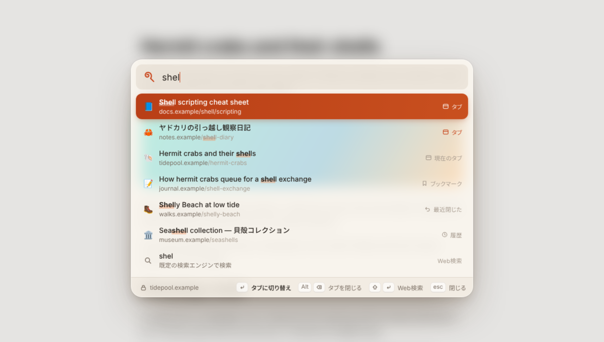

<div align="center">


# Yadokari

**A command bar and automatic tab archiving for Chrome.**

[](https://github.com/eucyt/yadokari/actions/workflows/test.yml)
[](https://github.com/eucyt/yadokari/releases/latest)
[](LICENSE)


English | [日本語](README.ja.md)

<picture>
  <source media="(prefers-color-scheme: dark)" srcset="docs/bar-dark.png">
  
</picture>

</div>

*Yadokari* is Japanese for hermit crab. Chrome is the shell, and this is what I carried in to make it home.

## Features

| Feature | What it does |
|---|---|
| Command bar | One input that fuzzy-searches tabs, bookmarks, history and recently closed tabs. Type `>` for commands such as duplicate, pin and copy URL. |
| Tab auto-close | Tabs unused for 12 hours are closed and kept in a searchable archive for 30 days. Pinned, visible and audible tabs are left alone. |

The interface is in Japanese for now.

## Install

Yadokari is not on the Chrome Web Store. You load it as an unpacked extension.

1. Download `yadokari-<version>.zip` from [Releases](https://github.com/eucyt/yadokari/releases/latest) and unzip it.
2. Open `chrome://extensions` and turn on **Developer mode**.
3. Click **Load unpacked** and pick the unzipped folder.
4. Check the shortcut at `chrome://extensions/shortcuts`. Assign it by hand if another extension already took it.

To update, unzip the new release into the same folder and reload the extension.

## Usage

Press **⌃T** on macOS or **Ctrl+Shift+K** elsewhere. Chrome reserves ⌘T, so an extension cannot use it.

| Key | Action |
|---|---|
| ↑ ↓, Tab, Ctrl+N / Ctrl+P | Move the selection |
| Enter | Switch to the tab, or open the result in a new tab |
| ⌥Enter | Open in the current tab |
| ⇧Enter | Search the web for what you typed |
| Ctrl+⌫ | Close the selected tab |
| Esc | Close the bar |

On Windows and Linux, ⌥ is Alt and closing a tab is Alt+⌫.

With an empty input the bar lists your other tabs, most recent first, so ⌃T then Enter jumps back to the previous tab.

<details>
<summary>More about search</summary>

- Words separated by spaces must all match.
- Input that looks like a URL (`github.com`, `localhost:3000`) gets an "open this URL" row at the top.
- When nothing matches, the bar retries allowing one typo: a dropped letter or two swapped neighbours.
- The footer shows the host of the page under the bar, in a warning colour when the page is not HTTPS.
- The footer also says what Enter does to the selected row, and which other keys work on it.
- The bar follows the system's light or dark appearance. Over a page it blurs the page behind it, unless the system is set to reduce transparency.

</details>

<details>
<summary>More about auto-close</summary>

- Run "アーカイブしたタブを表示" from `>` to list the archive, and Enter to reopen a tab. The archive holds up to 500 entries and stays out of normal search.
- Tabs in incognito windows are closed but never recorded.
- Run "タブの自動クローズをオフにする" from `>` to turn it off. Turning it back on gives every tab a fresh 12 hours.
- There is no timer. Expired tabs are closed when you switch, open, close or load a tab, so nothing closes while you are away.
- A reopened tab loads its URL again. Back/forward history and half-filled forms do not come back.

</details>

<details>
<summary>Settings</summary>

Open them from the extension's options, or run "Yadokariの設定を開く" from `>`.

| Setting | Default | Range |
|---|---|---|
| History window | 90 days | 1 to 365 days |
| History entries | 4,000 | 100 to 20,000 |
| Recently closed tabs shown before typing | 5 | 0 to 25 |
| Enter opens in | New tab | New tab or current tab. ⌥Enter does the other. |

</details>

## Privacy and permissions

- **No network access.** Search runs in memory over Chrome's own tab, bookmark, history and session APIs.
- **No standing access to websites.** The bar is injected with `activeTab`, which grants access only to the tab where you pressed the shortcut.
- **Pages cannot read the bar.** It is an extension page in an `iframe`, so page scripts see neither your input nor the results.
- **No dependencies and no build step.** What is in this repository is what Chrome runs.

`test/guardrails.test.js` enforces these rules on every commit.

<details>
<summary>What each permission is for</summary>

| Permission | Use |
|---|---|
| `tabs` | Read tab titles and URLs, switch tabs |
| `bookmarks` `history` `sessions` | Search sources, restoring closed tabs |
| `activeTab` `scripting` | Inject the bar into the tab where you pressed the shortcut |
| `search` | Web search with your default engine |
| `favicon` | Row icons |
| `storage` | Settings, the archive and auto-close state in `storage.local`. A per-session token, tab last-used times and a cache of bookmarks and history in `storage.session`, which is cleared when the browser quits. |

</details>

## Limitations

- Chrome does not allow injection into `chrome://` pages, the Web Store, the new tab page or the PDF viewer. There the bar opens as a toolbar popup.
- A page in fullscreen or showing a modal `<dialog>` can cover the bar.
- Incognito windows need "Allow in Incognito" turned on in the extension's details.

## Development

```sh
npm test            # unit tests and guardrails, nothing to install
npm run setup       # prepare the end-to-end tests (Linux only)
npm run check       # unit tests, then end-to-end tests in a real Chrome
npm run screenshots # retake docs/bar.png and docs/bar-dark.png
```

Project rules and layout are in [CLAUDE.md](CLAUDE.md), in Japanese.

This is a personal tool, so I may decline feature requests. Bug reports are welcome. Please open an issue before sending a pull request.

## License

[MIT](LICENSE)
